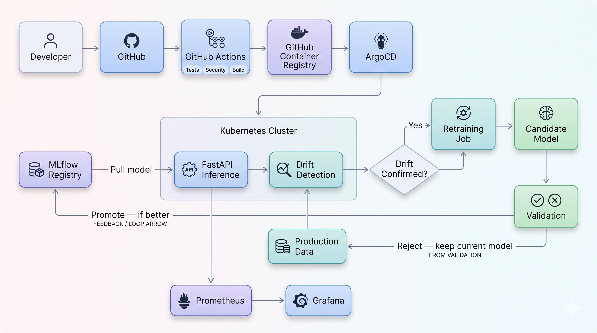

# Production-Grade MLOps Platform
### Automated Data Drift Detection, Model Retraining & GitOps Deployment

A closed-loop ML platform that serves predictions, monitors production data for drift,
automatically retrains when drift is confirmed, validates candidate models before
deployment, and ships approved models through CI/CD and GitOps — built as a companion
to a Cloud-Native DevSecOps platform, applying the same engineering depth to the ML
lifecycle.

**Live pieces:**
- Container image: `ghcr.io/sakib704596/credit-default-api`
- CI/CD: GitHub Actions (tests → CodeQL → secret scan → Trivy → build → push)
- Deployed via ArgoCD GitOps to a local Kubernetes (minikube) cluster

---

## The Problem

A model that performs well at training time can quietly degrade in production as
real-world input data shifts — **data drift**. Infrastructure monitoring (CPU, memory,
uptime) stays green the whole time, because nothing about the *infrastructure* is
broken. This project adds the missing layer: **ML-specific observability** — detecting
when the input distribution has shifted, deciding when that shift is real enough to
act on, retraining automatically, and never deploying a retrained model unless it's
proven better than what's already running.

## Architecture



---

## Phase-by-Phase Breakdown

### Phase 1 — Model Training & Evaluation
Trained an XGBoost classifier on the UCI "Default of Credit Card Clients" dataset
(~22% positive class). Used `scale_pos_weight` to counter class imbalance, and
evaluated with precision/recall/F1/ROC-AUC — accuracy alone is misleading on an
imbalanced problem (a "predict majority class" model would already score ~78%).

**Result:** ROC-AUC ≈ 0.776, recall ≈ 0.62 on the default class.
**Files:** `training/data.py`, `training/train.py`, `training/evaluate.py`

### Phase 2 — MLflow Experiment Tracking & Model Registry
Wrapped training with MLflow: every run logs params, metrics, and the model itself
to a named experiment, and registers a versioned entry (`credit-default-classifier`
v1, v2, ...) in the Model Registry — separate from the raw training run.

**Files:** `training/train_with_mlflow.py`

### Phase 3 — FastAPI Model Serving
Exposed the model over HTTP: `/predict`, `/health`, `/model/info`, `/metrics`,
`/drift/status`. Model loads once at startup (not per-request) from the MLflow
registry. Pydantic schemas validate every request.

**Files:** `app/api/main.py`, `app/api/schemas.py`

### Phase 4 — Containerization
Packaged the FastAPI service in Docker. Key decision: the container serves a
**specific, pre-exported model version** (`exported_model/`), not a live connection
to the full MLflow tracking database — avoids baking host-specific absolute paths
into the image, and matches how real deployments pin a validated model version.

**Files:** `Dockerfile`, `.dockerignore`

### Phase 5 — Drift Detection (KS + PSI)
Built a reference distribution from training data, then two independent detectors
compare any new batch against it:
- **KS test** (`scipy.stats.ks_2samp`) — are these two distributions statistically different?
- **PSI** (Population Stability Index) — *how much* has the distribution shifted?

Validated both against a known-normal sample (expect no drift) and a deliberately
drift-injected sample (expect confirmed drift on exactly the perturbed features).

**Files:** `training/build_reference.py`, `app/drift/detector.py`, `app/drift/simulate_drift.py`

### Phase 6 — Drift Aggregation, Retraining & Candidate Validation
The core governance loop. A feature only counts as "confirmed drifted" if **both**
KS and PSI agree (filters out single-detector noise). Confirmed drift triggers an
automatic retrain, but — critically — **the new candidate model is never deployed
just because it was retrained.** It's compared metric-by-metric against the current
production model (via an MLflow registry alias) and only promoted if it improves
without regressing on anything.

**Files:** `app/drift/aggregator.py`, `training/promotion.py`, `training/retrain_pipeline.py`

### Phase 7 — ML-Aware Observability (Prometheus + Grafana)
Extended the API with ML-specific Prometheus metrics (not just request counters):
`model_version_info`, `drift_confirmed`, `drift_pct_features_confirmed`,
`retrain_last_timestamp_seconds`. A `/drift/check` endpoint runs real detection live
and updates these gauges, so a Grafana dashboard reacts to an actual drift event in
real time — proven by triggering `/drift/check?simulate=true` and watching the panel flip.

**Files:** `monitoring/prometheus/prometheus.yml`, `docker-compose.yml`

### Phase 8 — CI/CD, Kubernetes & GitOps
- **CI/CD** (`.github/workflows/ci.yml`): unit tests → CodeQL static analysis →
  Gitleaks secret scanning → Docker build → Trivy vulnerability scan → push to GHCR.
  Each gate must pass before the next runs.
- **Kubernetes** (`kubernetes/base/`): Deployment (2 replicas, readiness/liveness
  probes on `/health`, resource limits), Service, dedicated `mlops` namespace.
- **ArgoCD** (`argocd/application.yaml`): Git is the source of truth. ArgoCD
  continuously reconciles the cluster to match what's declared in Git — proven by
  manually scaling the deployment to 5 replicas and watching ArgoCD automatically
  revert it back to 2 within seconds, with no manual intervention.

---

## Key Design Decisions (worth explaining in an interview)

1. **Never auto-deploy a retrained model.** Drift triggers retraining; only a
   validated, strictly-better candidate gets promoted. A candidate trained on
   identical data to production was correctly rejected (tied metrics); a candidate
   trained on a different data split was correctly promoted (every metric improved).
2. **Require detector agreement, not a single signal.** Testing showed KS alone can
   flag statistically significant but practically meaningless differences (sampling
   noise) on large batches. Requiring both KS and PSI to agree on a feature before
   counting it as "drifted" directly fixes this.
3. **Bake one validated model into the serving image**, rather than a live
   connection to the full MLflow store — simpler, more portable, and matches how
   production systems pin a specific approved version.
4. **CI vulnerability gate scoped to fixable, severity-relevant CVEs** (`ignore-unfixed:
   true`) — failing a pipeline on CVEs with no available patch doesn't improve
   security, it just trains people to ignore the pipeline.

---

## Project Structure

```
mlops-platform/
├── app/
│   ├── api/          # FastAPI service (main.py, schemas.py)
│   └── drift/         # Detection (detector.py), policy (aggregator.py), simulation
├── training/          # train.py, evaluate.py, MLflow integration, retraining pipeline
├── data/
│   └── reference/      # Reference distribution for drift comparison (committed)
├── tests/              # Unit tests (drift logic + schema validation, no dataset needed)
├── monitoring/
│   └── prometheus/      # Scrape config
├── kubernetes/
│   └── base/            # Namespace, Deployment, Service
├── argocd/              # ArgoCD Application manifest
├── .github/workflows/   # CI/CD pipeline
├── exported_model/       # Validated model version baked into the Docker image
├── Dockerfile
├── docker-compose.yml    # API + Prometheus + Grafana, for local observability demo
└── requirements.txt
```

---

## Running It Locally

**1. Train and set up MLflow:**
```bash
cd training
python build_reference.py
python train_with_mlflow.py
python promotion.py   # bootstraps the "production" alias
```

**2. Serve + observe (API, Prometheus, Grafana together):**
```bash
docker compose up --build
```
- API: http://localhost:8000/docs
- Prometheus: http://localhost:9090
- Grafana: http://localhost:3000 (admin/admin)

**3. Deploy to Kubernetes:**
```bash
kubectl apply -f kubernetes/base/
kubectl port-forward -n mlops svc/credit-default-api 8000:80
```

**4. GitOps with ArgoCD:**
```bash
kubectl create namespace argocd
kubectl apply -n argocd -f https://raw.githubusercontent.com/argoproj/argo-cd/stable/manifests/install.yaml
kubectl apply -f argocd/application.yaml
```

---

## What's Not Included (Scope Decisions)

- **ADWIN** streaming drift detection — marked optional in the original spec;
  KS + PSI cover the core data drift use case.
- **AWS EKS / Terraform** — the local-first approach (minikube) proves the full
  workflow without cloud cost; extending to EKS is a drop-in infrastructure change,
  not a redesign, since the Kubernetes manifests themselves don't change.
- **Vault / S3** — marked optional in the original spec; local secrets and
  artifact storage are sufficient to demonstrate the architecture.

---

## Tech Stack

**ML:** scikit-learn, XGBoost, scipy, MLflow
**Serving:** FastAPI, Uvicorn, Pydantic
**Containers/Orchestration:** Docker, Kubernetes (minikube), ArgoCD
**CI/CD:** GitHub Actions, CodeQL, Gitleaks, Trivy, GHCR
**Observability:** Prometheus, Grafana
